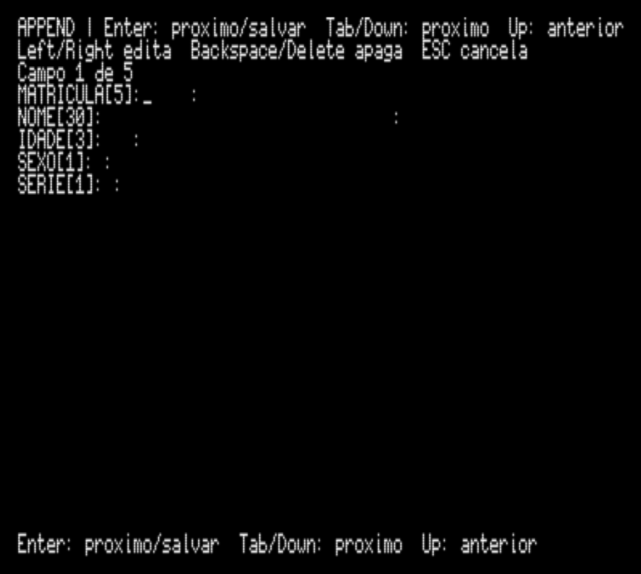
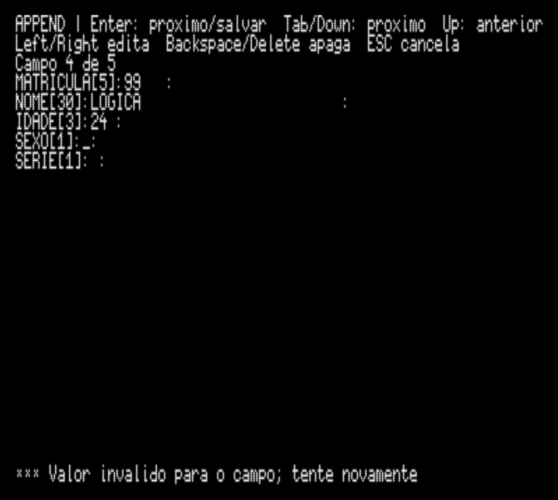
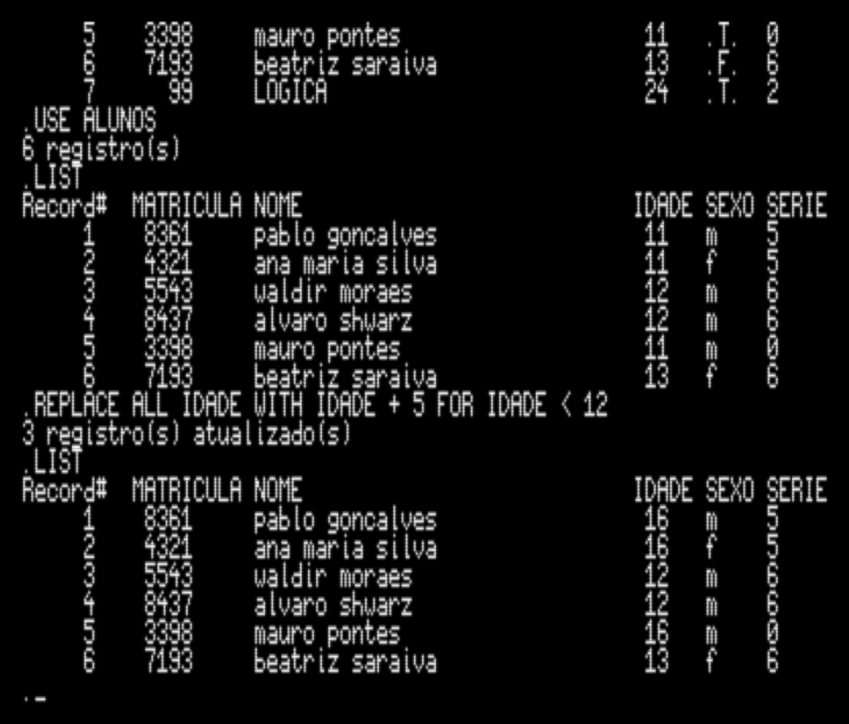
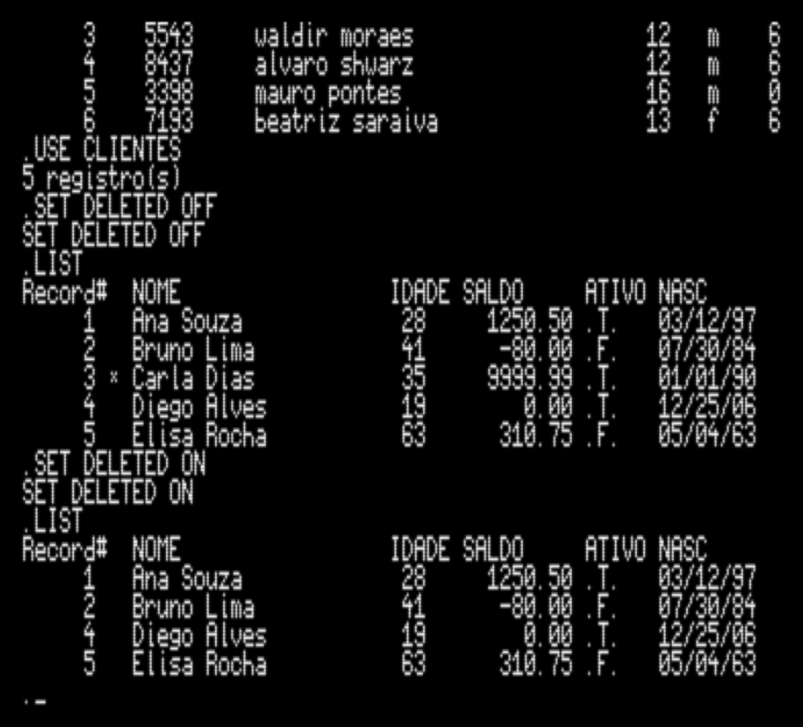
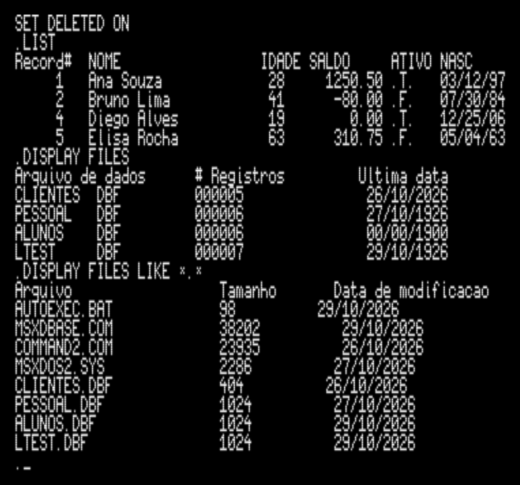

# MSX dBASE

Clone *clean room* do dBASE II para MSX, com melhorias de interface e evolucao
gradual de recursos do dBASE III. O escopo e o roteiro estao em
[SPEC.md](./SPEC.md).

Versao atual: **3.1 Grep**. Veja o [manual do usuario](./MANUAL.md), as
[notas do release](./RELEASE.md) e o [Changelog](./Changelog.MD).

`HELP` sem argumentos mostra um resumo local e nao acessa o disco. `HELP DBASE`
e `HELP <COMANDO>` podem carregar topicos de `DB8SEMSG.TXT`, fornecido pelo
usuario. Esse arquivo original nao e incluido no repositorio nem no release.
`SET HELP TXT|SCREEN` escolhe texto paginado ou janela; SCREEN exige `SET MSX ON`.
`SET MSX OFF` e o padrao e mantem a interface em modo TXT/monocromatico.

## Estado atual

O projeto usa C/SDCC, MSXgl e MSX-DOS 2. A CLI oferece console de 80 colunas,
leitura de DBF II MSX e leitura DBF III para interoperabilidade. Mutacoes sao
suportadas apenas em DBF II.

`APPEND` abre todos os campos C/N/L em um formulario simultaneo. `Enter`, `Tab`
e `Down` avancam; `Up` volta; `Left`/`Right` movem o cursor; `Backspace`/`Delete`
editam; `Esc` cancela sem gravar. Campos vazios ficam em espacos, valores
invalidos permanecem selecionados e o registro so e anexado apos validacao.
`SET COLON ON/OFF` mostra ou oculta os delimitadores `:` nas duas extremidades
das faixas de entrada. `APPEND BLANK` continua disponivel.
`SET CONFIRM ON` e o padrao e exige Enter/Tab/Down para avancar; com `OFF`,
campos completos avancam automaticamente e preencher o ultimo campo grava o
registro e inicia outro formulario. O comportamento vale para `APPEND` e `INSERT`.

`INSERT [BEFORE] [BLANK]` insere em relacao ao registro atual: por padrao depois
dele, ou antes com `BEFORE`. Sem `BLANK`, usa o formulario C/N/L; com `BLANK`,
grava espacos. O ponteiro termina no registro inserido.

`SET DELETED ON/OFF` controla o filtro de registros marcados em `LIST`,
`DISPLAY` e `REPLACE ALL`. `REPLACE ALL` aceita expressoes numericas basicas e
um `FOR` com uma comparacao numerica (`=`, `<>`, `!=`, `<`, `<=`, `>` ou `>=`),
sem `AND`/`OR`. `DISPLAY FILES` lista DBFs; `LIKE` permite buscar outros nomes e
extensoes usando um padrao literal, sem completar a extensao. `DELETE`,
`RECALL` e `PACK` tambem estao disponiveis.

As validacoes de `APPEND L`, `SET DELETED`, `DISPLAY FILES` e `REPLACE ALL FOR`
foram executadas no openMSX em copias temporarias. Mantenha backups antes de
operacoes de mutacao; testes de recuperacao apos falha continuam pendentes.

## Capturas

Formulario simultaneo C/N/L e validacao do campo Logical:



Correcao de um valor Logical invalido:



`REPLACE ALL ... FOR` altera apenas os registros que satisfazem a condicao:



`SET DELETED ON` oculta o registro marcado:



`DISPLAY FILES LIKE *.*` lista os arquivos encontrados:
Essa captura usa `LTEST.DBF`, fixture Logical temporaria criada somente para os testes; ela nao faz parte do DSK distribuido.



## Ajuda online

O resumo de comandos e local. Os topicos detalhados dependem do arquivo
`DB8SEMSG.TXT` do dBASE II original, que nao e redistribuido. O viewer SCREEN
tem busca, rolagem e paginacao; a validacao visual final desta versao continua
pendente. As capturas HELP em `docs/screenshots/` pertencem a testes anteriores.

## Compilar no Windows

Execute `.\build.ps1` na raiz do repositorio. O script chama o builder do
MSXgl usando os arquivos da pasta [project](./project/). É necessário ter
Node.js disponível no `PATH`, além das ferramentas SDCC e MSXhex esperadas em
`MSXgl/tools`.
O console usa a fonte ASCII embutida do MSXgl para que pontuação e símbolos
correspondam aos códigos das strings e para manter o cursor na linha de base.
O disco de teste inclui `PESSOAL.DBF` e `ALUNOS.DBF`, ambos DBF II MSX. A leitura
dos dois foi validada no openMSX; `APPEND BLANK` foi comparado byte a byte em
cópias, incluindo arquivos com tamanhos de registro diferentes.

O perfil está configurado para MSX2 (`Machine = "2"`) e MSX-DOS 2
(`Target = "DOS2"`). O build gera `project/out/msxdbase.com` e, quando a
versão Windows `MSXgl/tools/build/msxtar/msxtar.exe` está disponível, também
gera a imagem de disco `project/emul/dsk/DOS2_msxdbase.dsk`, com o sistema
MSX-DOS 2 e o executável. `DB8SEMSG.TXT` e incluído no DSK local somente se
existir em `resource/dbaseII/files/`; o projeto compila sem esse arquivo.
O alvo de uso previsto é um MSX2 com 1024 KB de RAM; essa capacidade é uma
característica do hardware e não uma opção de compilação do formato `.COM`.

Argumentos adicionais são encaminhados ao builder do MSXgl, por exemplo:

```powershell
.\build.ps1 clean
```

O comando `VER` mostra a versao embutida no executavel. Cada compilacao
bem-sucedida incrementa automaticamente `Y` para a proxima compilacao. Durante
uma rodada de testes, mantenha a versao usando `.\build.ps1 -KeepVersion`;
`clean` tambem nao incrementa a versao. O codinome pertence a `X` e muda quando
um novo marco comeca; o incremento de `X` e a publicacao do release sao feitos
deliberadamente, com tag `X.Y`, `RELEASE.md` e `Changelog.MD` atualizados juntos.

O esquema combina referencias a Unix e C classicos sem usar nomes de pessoas.
Os codinomes atuais sao **Shell**, **Fork** e **Grep**.

Execute o `.COM` em um MSX2 com MSX-DOS 2. No prompt `.`, digite `HELP` para
ver os comandos disponiveis.

O alvo de build está configurado como MSX2. A detecção de MSX1 sem consultar a
ROM ainda não está implementada; portanto, não há garantia de uma mensagem de
aviso nesse hardware.
